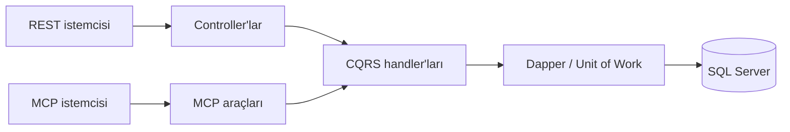

<p align="center">
  
</p>

# Ulu Bilge

**SQL Server verilerinize doğal dille soru sorun.**

UluBilge, ChatGPT ve Claude gibi Model Context Protocol (MCP) destekleyen yapay zekâ asistanlarını SQL Server verileriyle buluşturan, .NET 10 tabanlı açık kaynak bir REST API ve MCP sunucusudur.

Asistan veritabanının izin verilen şemasını keşfeder ve sorunuza uygun parametreli SQL hazırlar. UluBilge sorguyu doğrular, çalıştırır ve rapor sonucunu asistana iletir. Böylece farklı raporlama ihtiyaçları, her biri için ayrı bir endpoint geliştirmeden karşılanabilir.

Proje, Northwind örnek veritabanı üzerinde şema keşfi ve raporlama akışını gösterir.

**.NET 10 · ASP.NET Core · MCP · SQL Server · Dapper · CQRS**

[Web sitesi](https://ulubilge.uretimsistemi.com/) · [Hızlı başlangıç](#hızlı-başlangıç) · [MCP araçları](#mcp-araçları) · [Teknik rehber](docs/technical-guide.md) · [MIT lisansı](LICENSE.txt)

## Neler sunar?

- **Şemaya dayalı raporlama:** Asistan tablo ve view'leri, sütunları ve ilişkileri keşfederek soruya uygun sorguyu hazırlar.
- **Denetlenen SQL erişimi:** ScriptDom ile tek bir `SELECT` veya CTE sorgusu doğrulanır; izinli nesneler, parametreler, satır sayısı, yanıt boyutu ve süre sınırları kontrol edilir.
- **REST ve MCP için ortak iş mantığı:** Her iki erişim yolu aynı CQRS handler'larını, doğrulamayı ve Unit of Work yapısını kullanır.
- **OAuth ile bağlantı:** PKCE, dinamik istemci kaydı, rol ve kapsam kontrolleri, kısa ömürlü access token ve refresh token rotasyonu bulunur.
- **Geliştirici araçları:** Scalar/OpenAPI dokümantasyonu, MiniProfiler ile istek inceleme, NUnit testleri ve Bruno koleksiyonu içerir.
- **Türkçe ve İngilizce deneyim:** Web sitesi, OAuth ekranları ve örnek yemek menüsü iki dili destekler.

## Sorudan rapora

Asistanınıza şu tür sorular yöneltebilirsiniz:

> 1997 yılında kategori bazında indirim sonrası net satışları hesapla. Kargo bedelini dahil etme ve sonucu büyükten küçüğe sırala.

> Almanya'daki müşterileri şehirlerine göre grupla ve her şehirde kaç müşteri olduğunu göster.

Rapor akışı dört adımdan oluşur:

1. Kullanıcı, MCP istemcisi üzerinden giriş yapıp erişime izin verir.
2. Asistan, `get_database_schema` ile izin verilen şemayı ve sorgu sınırlarını alır.
3. Asistan, soruya uygun parametreli SQL'i `get_generic_report` aracına gönderir.
4. UluBilge sorguyu doğrular, SQL Server'da çalıştırır ve sonucu asistana döndürür.

Doğal dili yorumlayan ve SQL'i üreten model MCP istemcisinde çalışır. UluBilge içinde ayrıca bir LLM çalıştırılmaz.

## MCP araçları

Sunucu, Streamable HTTP üzerinden `/mcp` adresinde hizmet verir.

| Araç | Görevi |
| --- | --- |
| `get_database_schema` | İzinli tablo ve view'leri, sütunları, veri tiplerini, ilişkileri, şema sürümünü ve rapor sınırlarını getirir. |
| `get_generic_report` | Şemaya göre hazırlanmış parametreli SQL'i doğrulayıp çalıştırır; dinamik sütun ve satırlarla rapor döndürür. |
| `get_foods` | Günlük, haftalık veya aylık örnek öğle yemeği menüsünü Türkçe ya da İngilizce getirir. |

Menü aracıyla “Bugün öğle yemeğinde ne var?” veya “What is for lunch next week?” gibi sorular da sorulabilir. **Menüler örnek veridir; gerçek bir şirket menüsü kaynağı henüz bağlı değildir.**

## Hızlı başlangıç

.NET 10 SDK, Git ve erişebildiğiniz bir SQL Server gerekir. Aşağıdaki komutları depo kökünde çalıştırın.

### 1. Projeyi alın

```powershell
git clone https://github.com/ertugrulakdag/UluBilge.git
cd UluBilge
dotnet restore UluBilge.slnx
```

### 2. Veritabanı bağlantılarını ayarlayın

SQL Server'da bu örneğe ayırdığınız boş bir `Northwind` veritabanı oluşturun. Ardından sunucu, veritabanı ve kimlik doğrulama bilgilerinizi şu dosyalara uygulayın:

| Dosya | Ayarlanacak alanlar |
| --- | --- |
| [API ayarları](src/UluBilge.Api/appsettings.json) | `ConnectionStrings:ReadConnection` ve `ConnectionStrings:WriteConnection` |
| [Migration ayarları](src/UluBilge.Migration/appsettings.json) | `ConnectionStrings:WriteConnection` |

SQL kullanıcı adı ve parolasıyla bağlantı örneği:

```json
{
  "ConnectionStrings": {
    "ReadConnection": "Server=localhost;Database=Northwind;User Id=<kullanici>;Password=<parola>;Encrypt=True;TrustServerCertificate=True;ApplicationIntent=ReadOnly",
    "WriteConnection": "Server=localhost;Database=Northwind;User Id=<kullanici>;Password=<parola>;Encrypt=True;TrustServerCertificate=True;ApplicationIntent=ReadWrite"
  }
}
```

Bu bölümü API ayarlarına uygulayın; migration dosyasında yalnızca `WriteConnection` gerekir. API'de sorgular okuma bağlantısını, komutlar yazma bağlantısını kullanır.

### 3. Veritabanını hazırlayın

```powershell
dotnet run --project src/UluBilge.Migration
```

Migration, Northwind verilerini ve kullanıcı, token, OAuth istemci tablolarını hazırlar. API başlarken otomatik çalıştırılmaz.

> **Kurulum notu:** Master script bazı Northwind nesnelerini silip yeniden oluşturur. Migration'ı bu örnek için ayırdığınız veritabanında çalıştırın.

Yerel deneme hesabı `admin / admin` olarak oluşturulur. Yayına geçmeden önce bu hesabın parolasını değiştirin.

### 4. API'yi başlatın

```powershell
dotnet build UluBilge.slnx
dotnet run --project src/UluBilge.Api --launch-profile http
```

| Adres | Açıklama |
| --- | --- |
| [localhost:5156](http://localhost:5156/) | Web sitesi |
| [localhost:5156/docs](http://localhost:5156/docs) | Scalar API dokümantasyonu |
| [localhost:5156/openapi/v1.json](http://localhost:5156/openapi/v1.json) | OpenAPI belgesi |
| `http://localhost:5156/mcp` | MCP bağlantı adresi |

Scalar ve OpenAPI yalnızca Development ortamında açıktır. API açılırken rapor şeması veritabanından yüklenir; bu yüzden SQL Server bağlantısı hazır olmalıdır.

## MCP istemcisine bağlanma

MCP istemcinizde sunucu adresi olarak yerel geliştirmede `http://localhost:5156/mcp`, yayın ortamında `https://<sunucu-adresiniz>/mcp` kullanın. OAuth akışında UluBilge hesabınızla giriş yapıp erişime izin verin.

Bulutta çalışan istemciler için erişilebilir bir HTTPS adresi gerekir. `OAuth:ServerUrl` ayarına bu adresin kökünü yazın; `/mcp` eklemeyin.

Claude Desktop ile yerel kullanım için Node.js/npm ve `mcp-remote` köprüsünü kullanan hazır yapılandırmalar bulunur:

- [Yerel bağlantı örneği](docs/claude-desktop.local.example.json)
- [Yayın ortamı bağlantı örneği](docs/claude-desktop.production.example.json)

Örneklerdeki Node.js dosya yollarını kendi kurulumunuza göre düzenleyin. OAuth akışı, roller ve bağlantı ayrıntıları [teknik rehberde](docs/technical-guide.md) açıklanmıştır.

## Mimari

REST controller'ları ve MCP araçları aynı uygulama katmanına bağlanır:



| Proje | Sorumluluk |
| --- | --- |
| `UluBilge.Api` | REST endpoint'leri, MCP araçları, OAuth, web sayfaları ve OpenAPI |
| `UluBilge.App` | Command/query handler'ları, doğrulama, kimlik doğrulama ve işlem akışı |
| `UluBilge.Data` | Dapper repository'leri, bağlantılar, Unit of Work, şema keşfi ve SQL denetimi |
| `UluBilge.Core` | Entity'ler, ortak modeller ve CQRS sözleşmeleri |
| `UluBilge.Migration` | SQL kurulum scriptleri ve migration geçmişi |

Proje bağımlılıkları `Api → App → Data → Core` yönündedir. Handler ve repository kayıtları Scrutor ile otomatik yapılır; bağlantı ve transaction yönetimi decorator'larla uygulanır.

## Yayın ayarları

- **Derleme ve ortam:** Release derlemesi ve Production ortamı kullanın. Debug derlemelerinde `RoleAuthorize` kullanılan REST endpoint'lerinde kimlik ve rol kontrolleri atlanır; MCP erişim kontrolleri her derlemede uygulanır.
- **Adres ve anahtar:** HTTPS adresinizi `OAuth:ServerUrl` ile, kendi JWT imzalama anahtarınızı `Jwt__SigningKeyBase64` ortam değişkeni veya secret store üzerinden tanımlayın.
- **Veritabanı yetkileri:** Okuma hesabının SQL yetkilerini ayrıca sınırlandırın. `ApplicationIntent=ReadOnly` bir yetkilendirme kuralı değildir.
- **Tanılama erişimi:** `/mini-profile/results-index` mevcut yapılandırmada Production dahil giriş gerektirmeden açılır. İstek ve yanıt ayrıntıları maskelenmeden kaydedildiğinden bu yolu yayın ortamınızda erişim kontrolüyle sınırlandırın.

Şema kuralları, rapor sınırları, token yenileme, hata yanıtları ve tanılama davranışı için [teknik rehbere](docs/technical-guide.md) bakın.

## Katkı ve lisans

Hata bildirimleri ve geliştirme önerileri için issue, katkılarınız için pull request açabilirsiniz.

**Geliştirici:** [Ertuğrul Akdağ](https://github.com/ertugrulakdag) · **Lisans:** [MIT](LICENSE.txt)
